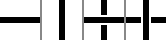
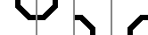
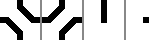

# Knot Science

The idea is to figure out a way to model knots on a 2D grid.

## KnotEditor

The fun part! You get to draw out your knots. KnotSolver will run properly iff you have one knot at a time AND the ends of your knot are capped (use the end pieces).

## KnotSolver

Guys reidemeister() freaking identifies slipknots by utilizing the Reidemeister moves in a way that is provably analogous to ambient isotopies in 3D space
Now, I know what you're thinking. "Erm in English please?"
Human moves a knot in real life without changing the knot structure
Code moves a knot in code without changing the knot structure in the same way

### Controls

**Mouse**:

| Button | Function |
| --- | --- |
| left | place tile |
| middle | swap (for tiles with 2 paths) |
| right | delete tile |

**Keyboard**:

| | | | | |
| --- | --- | --- | --- | --- |
| 1 | 2 | 3 | 4 |  |
| Q | W | E | R |  |
| A | S | D | F |  |
| Z | X | C | V |  |

<!--  -->

## TODO

**Knot sure**:

- $10

**KnotEditor**:

- make the cap piece show up when you let go of the mouse on a 1 or 2 (this is literally what the code is gonna look like but I'm writing this in bed at 12:56am so I'll do it tomorrow (later today))

## Credits

Michael Reed: for getting me excited about tying rope into fun shapes

Wikipedia: for providing a parametric equation of a figure-8 knot in 3D space

Kurt Reidemeister: for coming up with the moves 💯

And you! Just kidding you didn't do any of the work
