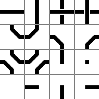

# Knot Science

The idea is to figure out a way to model knots on a 2D grid.

## KnotEditor

The fun part! You get to draw out your knots. KnotSolver will run properly iff you have one knot at a time AND the ends of your knot are capped (use the end pieces).

### Controls

**Mouse**: click and drag

**Keyboard**:

<!-- | Key | Function |
| --- | --- |
| 1 | Horizontal |
| 2 | Vertical |
| 3 | Horizontal-on-top crossing |
| 4 | Vertical-on-top crossing |
| QWER | Corners |
| AS | Double corners |
| DXCV | End pieces |
| F | Dot |
| Z | Empty | -->

| | | | | |
| --- | --- | --- | --- | --- |
| 1 | 2 | 3 | 4 |  |
| Q | W | E | R |  |
| A | S | D | F |  |
| Z | X | C | V |  |

<!--  -->

## TODO

**KnotInfo**:

- inspect chain sinnet / slipknot closely
- find inner regions (figure out how to do it in the first place lol)

**KnotSolver**:

- implement double corners

## Credits

Michael Reed: for getting me excited about tying rope into fun shapes

Wikipedia: for providing a parametric equation of a figure-8 knot in 3D space

Kurt Reidemeister: for coming up with the moves 💯

And you! Just kidding you didn't do any of the work
